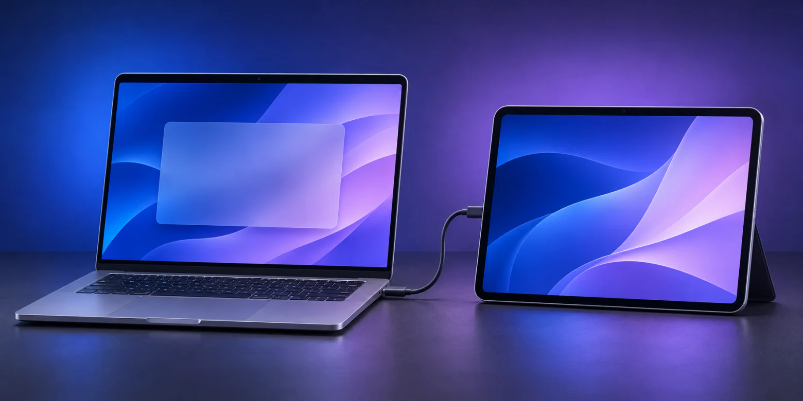
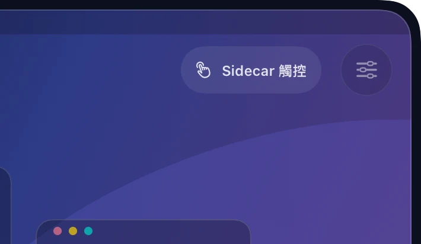
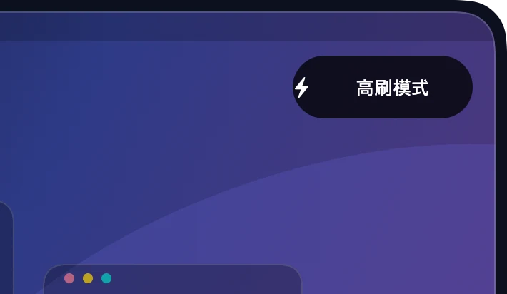
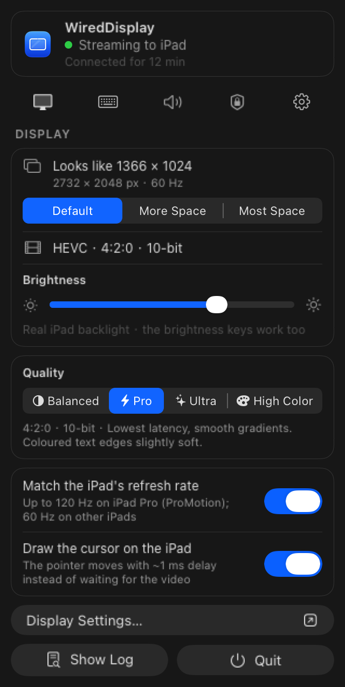
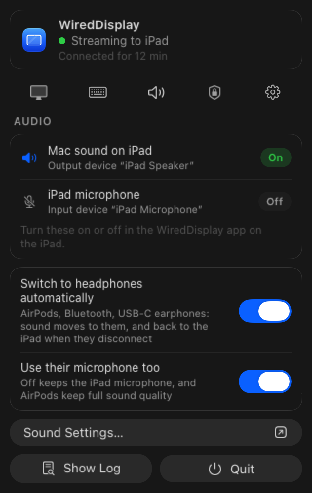

# AutoSidecar Companion 0.2.0

繁體中文 · [English](README.en.md)

**用一條 USB-C 資料線，把 iPad 變成 Mac 的有線延伸螢幕，畫面和聲音一起傳。**

- **Mac 音效從 iPad 播放**。透過 USB 傳送 48 kHz 雙聲道無壓縮 PCM，從 iPad 喇叭或所選的耳機播放，音量可在 macOS 調整。
- **Retina 原生解析度、最高 120 FPS 串流**。依 iPad 面板自動調整解析度與更新率，ProMotion 機型可協商高刷，也可選用 60 Hz 相容模式。
- **支援 HDR10**。需要 macOS 26 以上、相容的 Mac 擷取與編碼，以及支援 HDR 的 iPad。HDR 條件不足時會自動使用 SDR。

**高刷桌面請使用連到 Mac 的鍵盤與滑鼠。** 公開版 Companion 的高刷觸控仍待實機驗收。

## 下載

[下載 AutoSidecar Companion 原始碼（ZIP）](https://github.com/azx4121/AutoSidecar-Companion/archive/main.zip)

**目前提供原始碼開發預覽。** 下方有 Mac 安裝包的建置指令，以及用 Xcode 把接收器直接裝到 iPad 的做法。

**正式版安裝流程（待發行與實機驗證）**。雙擊 Mac 安裝包 → 用 iPad 相機掃描 Mac 設定畫面的 QR 碼，安裝並開啟接收器 → 插上 USB-C，核對兩端的配對碼並依 macOS 提示授權。Mac 安裝包內含音訊元件。



*單線延伸桌面示意圖。*

## iPad 右上角切換高刷與一般模式（Mac mini 原型）

**高刷模式目前無法用 iPad 觸控螢幕點按或拖曳 Mac 桌面。** iPad 右上角的模式按鈕可以點選。

- **從高刷切到一般模式**。需要用手指操作 Mac 時，在 iPad 右上角點「Sidecar 觸控」，切到原生有線並行（Sidecar）的 60 Hz 相容模式。
- **從一般切回高刷模式**。在 iPad 右上角點「高刷模式」，回到 USB Retina 高刷桌面。

<p align="center">
  
  
</p>

*範例桌面重現 Mac mini 原型的兩個按鈕與位置。*

**公開版 Companion** 從 Mac 選單列的 **Display → Match the iPad’s refresh rate** 調整。開啟時依 iPad 協商更新率，關閉時把 Companion 串流上限設為 60 Hz。

## 系統需求

- **Mac** 需要 macOS 14 以上。畫面的 HDR10 路徑需要 macOS 26 以上、相容的 Mac 擷取與編碼，以及支援 HDR10 的 iPad 接收端。
- **iPad** 需要 iPadOS 17 以上。請以可傳資料的 USB-C 線連接。
- **虛擬螢幕**由公開版 Companion 建立，使用時無需安裝 BetterDisplay。
- **建置環境**使用完整 Xcode、Swift 6 工具鏈、macOS 與 iOS SDK、Python 3。此版本已用 Xcode 27.2 建置。

## 建置開發預覽

在專案根目錄執行。若系統目前使用 Command Line Tools，可在同一個終端機先設定 `export DEVELOPER_DIR=/Applications/Xcode.app/Contents/Developer`，或改成你安裝的 Xcode 路徑。

```sh
python3 build-mac.py dist/AutoSidecar-Companion.pkg
```

Mac 建置預設包含 Apple 晶片與 Intel 架構，僅需 Apple 晶片時可加 `--arch arm64`。建置產生的 Mac App 預設採用臨時簽章，PKG 預設未簽署，供本機開發測試。下一步在 Xcode 直接將接收器安裝到 iPad。

## 安裝預覽版與配對

1. **Mac**。開啟自己建置的 `dist/AutoSidecar-Companion.pkg`，依 Installer 提示完成本機安裝。套件包含 `/Applications/AutoSidecar Companion.app` 與 Core Audio 音訊元件。若選單列沒有出現 App，從「應用程式」開啟並按「開始設定」。
2. **iPad**。用 Xcode 開啟 [WiredDisplayClient.xcodeproj](iPadOSClient/WiredDisplayClient/WiredDisplayClient.xcodeproj)，選 `WiredDisplayClient` scheme。在 **Signing & Capabilities** 選自己的開發團隊，並使用團隊可用的 Bundle Identifier。用 USB-C 資料線接 iPad，解鎖並依提示信任這部 Mac。選 iPad 為執行目的地，再按 Run。若系統提示，依 Apple 的說明啟用「開發者模式」。[Xcode 裝置執行](https://developer.apple.com/documentation/xcode/running-your-app-on-simulated-or-physical-devices) · [開發者模式](https://developer.apple.com/documentation/xcode/enabling-developer-mode-on-a-device) · [信任這部電腦](https://support.apple.com/zh-tw/109054)
3. **首次配對**。讓 Mac 已登入、iPad 接收器在前景。核對兩端顯示的配對碼，相同才在 Mac 和 iPad 各自確認。
4. **提供所需權限**。在 Mac 的「系統設定 → 隱私權與安全性」允許螢幕錄製。要在 iPad 播放 Mac 聲音時，也要允許 Mac App 使用「麥克風」權限讀取虛擬音訊裝置。若要測試 iPad 輸入功能，請勾選允許輸入並核准「輔助使用」。依系統提示重新開啟 App。iPad 麥克風預設關閉。[Apple 螢幕錄製](https://support.apple.com/zh-tw/guide/mac-help/mchld6aa7d23/mac) · [Apple 麥克風權限](https://support.apple.com/zh-tw/guide/mac-help/mchla1b1e1fe/mac)
5. **日常使用**。在 Mac 登入後，維持 iPad 接收器在前景再插線，已配對的裝置會嘗試重連。若 iPad 的接收器已關閉，先解鎖並開啟 App。要播放 Mac 聲音，在接收器啟用「Mac audio on this iPad」，並從 Mac 的「聲音」設定調整「iPad Speaker」音量。配對和串流從 macOS 使用者登入後開始。

## 畫面、聲音與連線

- 主機依 iPad 接收器讀到的面板像素、縮放和更新率協商。高更新率的協商上限是 120 FPS。接收器會等待面板資訊就緒。iPad 回報較低上限、開啟低耗電模式或手選 60 Hz 相容模式時，按對應上限協商。若高刷或 HDR 路徑啟動失敗，主機分階段重試，必要時保留解析度並回到 60 Hz SDR。
- USB 為預設路徑。音訊串流使用 48 kHz 雙聲道 PCM，實際播出取樣率與聲道依 iPad 的輸出裝置。拔線時會嘗試釋放虛擬顯示器並還原由本程式切換的 Mac 音訊輸出。
- **Wi-Fi 為開發測試路徑**。先經 USB 配對，兩端使用同一個區域網路。iPad 可在接收器選「使用 Wi-Fi 連線」，並依系統提示啟用區域網路權限。Mac 端先結束原本的 USB 主機，再以 `open -a "AutoSidecar Companion" --args --lan-interface en0` 啟動 LAN 主機。將 `en0` 換成本機連上該區網的介面名稱。iPad 可用 Bonjour 探索，或使用有線會話記住的區網位址再驗證配對金鑰。完全拔線後的自動重連、控制及長時間音訊仍待本版實機驗收。

## Mac 介面預覽

<p align="center">
  
  
</p>

*Mac 選單列的顯示與音訊設定。畫面由程式以範例資料產生。*

## 驗證範圍

```sh
swift test
python3 CompanionTests/check_mac.py dist/AutoSidecar-Companion.pkg
bash build-receiver.sh dist
python3 CompanionTests/check_receiver.py dist/AutoSidecar-iPad-unsigned.ipa
python3 CompanionTests/check_audio_routes.py .
mkdir -p dist
xcrun swiftc -swift-version 6 macOSHost/Host/MacBookLayout.swift CompanionTests/layout-tests.swift -o dist/layout-tests
./dist/layout-tests
```

**已驗證**。Mac 通用安裝包與 iPadOS 裝置版編譯及封裝檢查、iPadOS 模擬器版編譯、190 項 Swift 單元測試、MacBook 與 Mac mini／XREAL 佈局模擬，以及立體聲與單聲道的離線音訊測試。

**待實機驗證**。此版本在不同 iPad 上的實體 USB 配對、MacBook 外放和輸入、Mac mini 無螢幕冷啟動及 XREAL 拔插接手。120 FPS 是協商上限，接收器統計屬軟體量測。模擬器只供編譯檢查，實體 iPad 才能取得 Metal 畫面呈現回呼。面板實際更新率、HDR 亮度及聲音延遲仍需量測。Mac 虛擬螢幕使用執行時取得的 `CGVirtualDisplay` 私有 API，支援狀況會隨系統版本而異。

## 簽署與授權

維護者使用已加入 Apple Developer Program 的團隊，在 Xcode 登入後設定 `RECEIVER_TEAM_ID`。以下指令會封存接收器，並匯出可上傳 App Store Connect 的已簽署 IPA。

```sh
bash build-receiver.sh --release dist
```

將 `dist/AutoSidecar-iPad-AppStoreConnect.ipa` 上傳 App Store Connect，完成所選通路的送審與發行。取得 iPad 公開安裝連結後，用下列指令建立 Mac 發行包。建置會提交 Apple 公證、加上公證票證並驗證安裝包。

```sh
python3 build-mac.py --release dist/AutoSidecar-Companion.pkg
```

先設定 `APP_SIGN_IDENTITY`（Developer ID Application）、`INSTALLER_SIGN_IDENTITY`（Developer ID Installer）、`NOTARY_PROFILE`（已儲存於鑰匙圈的公證設定檔），以及 `AUTOSIDECAR_RECEIVER_URL`（App Store 產品頁或 TestFlight 公開邀請）。Mac 會以該網址顯示下載 QR 碼。iPad 版公開發行需完成簽署、審核及通路授權相容性確認。[Apple Mac 公證](https://developer.apple.com/documentation/security/notarizing-macos-software-before-distribution) · [Apple TestFlight](https://developer.apple.com/testflight/)

AutoSidecar Companion 0.2.0 修改自 sibawono 的 WiredDisplay，修改版日期為 2026 年 11 月 25 日。Mac 主機、iPad 接收端、通訊與音訊實作源自 [上游版本 64180c7](https://github.com/sibawono/WiredDisplay/tree/64180c7b9bed550bdd622e6c42c9d2e0773fc5ec)。依 [GNU GPL 第 3 版](LICENSE) 發佈。Companion 的改動見 [版本紀錄](docs/CHANGELOG.md)，兩端的專屬圖示可用 [`scripts/make-icons.sh`](scripts/make-icons.sh) 重新產生。
